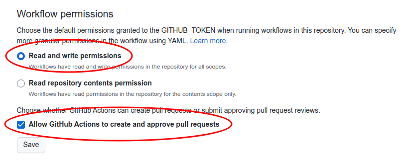
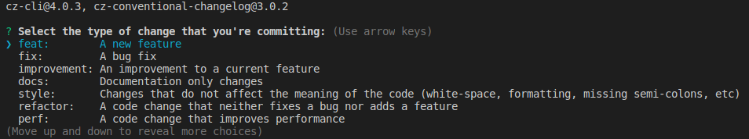

# Standard Commit

A practical guide for setting up a Conventional Commits workflow with Husky, Commitlint and Commitizen.

[](LICENSE)

## Why?

Instead of configuring Husky, Commitlint, Commitizen and Release Please individually, this guide shows how to combine them into a complete Conventional Commits workflow.

## Example

```text
feat(auth): add OAuth login

fix(api): prevent duplicate requests

docs(readme): improve installation guide
```

## Features

- Validate commit messages against the [Conventional Commits](https://conventionalcommits.org/) specification.
- Create commit messages interactively with Commitizen.
- Automate releases and `CHANGELOG.md` generation.
- Keep version numbers in sync with your release history.

## Installation

### 1. Install Dependencies

Install the necessary dependencies locally:

```sh
yarn add --dev husky @commitlint/cli @commitlint/config-conventional cz-conventional-changelog
```

### 2. Install Commitizen globally

Install Commitizen globally to enable standardized commit message formatting:

```sh
sudo yarn global add commitizen
```

### 3. Update `package.json`

Update your project's `package.json` file to configure Commitizen:

```json
{
  ...

  "config": {
    "commitizen": {
        "path": "./node_modules/cz-conventional-changelog",
        "disableScopeLowerCase": true
    }
  },

  ...
}
```

### 4. Configure Commitlint

Create a `commitlint.config.js` file in your project root directory to configure Commitlint:

```js
module.exports = {
  extends: ["@commitlint/config-conventional"],
  rules: {
    "scope-case": [0],
  },
};
```

### 5. Set up Husky

Edit `package.json > prepare` script and run it once:

```sh
npm pkg set scripts.prepare="husky install"
yarn prepare
```

Add a hook to run commitlint

```sh
npx husky add .husky/commit-msg "yarn commitlint --edit"
```

### 6. Configure Commitizen

Configure Commitizen to use the conventional changelog adapter:

```sh
commitizen init cz-conventional-changelog --save-dev --save-exact
```

### 7. Set up Release Please

Automate release management with Release Please:

#### Deploy release-please with GitHub Action by creating a `.github/workflows/release-please.yml` file with these contents:

```yaml
on:
  push:
    branches:
      - main
name: release-please
jobs:
  release-please:
    runs-on: ubuntu-latest
    steps:
      - uses: google-github-actions/release-please-action@v3
        with:
          release-type: node
          package-name: release-please-action
```

#### Make sure you have the correct _Workflow permissions_ on your repository (Settings > Actions > General):



## Usage

Standard Commit simplifies the process of writing standardized commit messages:



### Using Commitizen

Instead of `git commit`, use `git cz` to open a wizard and generate a standardized commit message:

```sh
git add .
git cz
git push --follow-tags
```

### Normal commit command

You can still use `git commit ...` but the commit will fail if the commit message is not properly formatted.

```sh
git add .
git commit -m "feat(blog): add comment section"
git push --follow-tags
```

## Built with

- [commitizen](https://github.com/commitizen/cz-cli) helps format commit messages with a series of prompts
- [husky](https://github.com/typicode/husky) will trigger the commitlint on each commit
- [commitlint](https://github.com/conventional-changelog/commitlint) checks if your commit messages meet the [Conventional Commits](https://conventionalcommits.org/) specification
- [release-please](https://github.com/googleapis/release-please) automates `CHANGELOG.md`, bump the version and generate a new release

## Contributing

Want to contribute? All contributions are welcome. Read the [contributing guide](CONTRIBUTING.md).

## Questions

Questions, suggestions and bug reports are welcome. Feel free to [open an issue](../../issues/new).

## License

This project is licensed under the MIT License. See the [LICENSE](LICENSE) file for details
